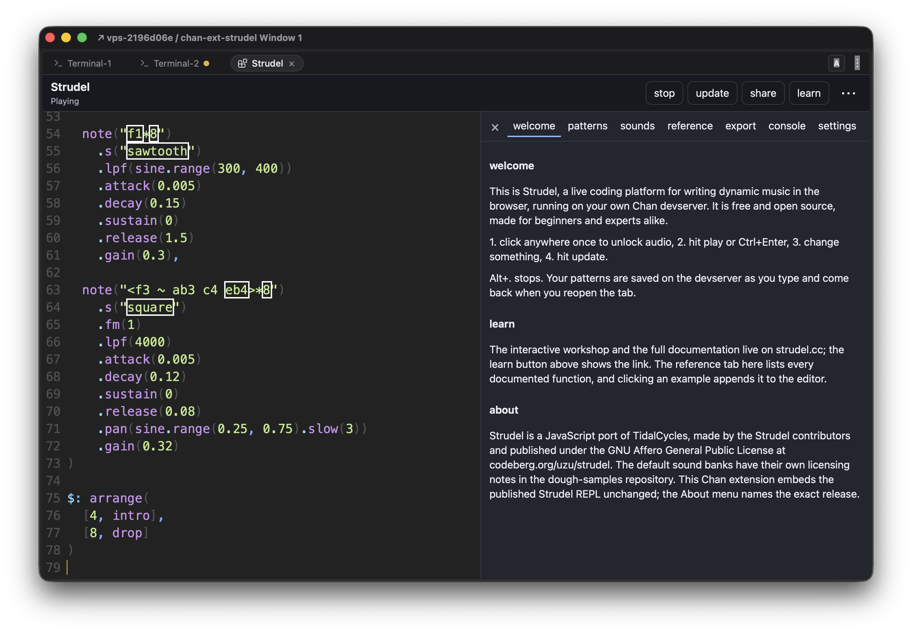

# Strudel

A [Chan](https://github.com/fiorix/chan) extension that self-hosts the [Strudel](https://strudel.cc) live-coding REPL in a Chan tab.



Strudel is the work of its contributors, published under the GNU Affero General Public License v3 or later at [codeberg.org/uzu/strudel](https://codeberg.org/uzu/strudel). This extension embeds the published `@strudel/repl` bundle unchanged and rebuilds the strudel.cc shell around it: the play, update, share, and learn buttons, and a panel with welcome, patterns, sounds, reference, export, console, and settings tabs. What it adds is reaching Strudel through Chan, from the desktop, from a phone over the gateway, or from another machine, with your patterns and settings kept on the devserver. Everything you write and hear is Strudel.

## Install

Install the latest release and restart Chan:

```sh
curl -fsSL https://github.com/fiorix/chan-ext-strudel/releases/latest/download/install.sh | bash
chan devserver --restart
```

Pin a release with `CHAN_EXT_STRUDEL_VERSION=v0.1.0` in the environment of that command, or build and install this checkout with `./scripts/install-chan-extension.sh`. Both install under `~/.local/lib/chan-ext-strudel` and write the declaration at `~/.chan/extensions/strudel.toml`; override the roots with `CHAN_EXT_STRUDEL_INSTALL_ROOT` and `CHAN_HOME`. After the restart, open **Strudel** from the command launcher's Apps category.

Releases ship one static binary per target, each compiled and tested on its own GitHub-hosted runner. The Linux builds target musl, so they carry no libc dependency. The installer verifies the archive against `SHA256SUMS` before extracting anything.

| Platform | Archive |
|---|---|
| Linux x86_64 | `chan-ext-strudel-linux-x86_64.tar.gz` |
| Linux aarch64 | `chan-ext-strudel-linux-aarch64.tar.gz` |
| macOS aarch64 | `chan-ext-strudel-macos-aarch64.tar.gz` |
| Windows x86_64 | `chan-ext-strudel-windows-x86_64.zip` |

## Use

Click anywhere in the tab once: browsers start audio only after a gesture. Ctrl+Enter or Alt+Enter evaluates the pattern, and Alt+. stops it; the play and update buttons do the same. Strudel also stops on Ctrl+., but inside the tab that chord goes to Chan whenever Chan claims it. Chan's shortcuts keep working while the editor has focus through Chan's v2 keyboard relay, in Chan v0.100.0 or newer; with an older Chan the tab keeps those keystrokes.

The panel beside the editor carries the strudel.cc tabs. **Patterns** keeps one entry per pattern, saved on the devserver about a second after each change and separately for each Chan session; new, duplicate, and delete work as on strudel.cc, and a pattern's title comes from a first-line `// "title"` comment. **Sounds** lists every registered sound by kind; hold a name to preview it. **Reference** is the documented function list, and clicking an example appends it to the editor. **Export** renders cycles offline to a WAV and writes it under `~/.chan/strudel/exports/`, since the sandbox blocks downloads. **Console** shows Strudel's log. **Settings** covers the editor (theme, font, keybindings, highlighting), polyphony, multi-channel orbits, and the panel position, all saved with the session.

**Share** shows a strudel.cc link carrying the current pattern and **learn** the workshop link; both are shown as text to copy, because the sandbox blocks pop-ups. Sound keeps playing while another tab is in front. **Toggle Strudel Presentation** in the launcher fills the window with the editor; Chan's Restore and Close controls bring it back. The About menu names the Strudel release in use and where its source lives.

## Local samples

Put sample kits under `~/.chan/strudel/samples/` (`$CHAN_HOME/strudel/samples/` when `CHAN_HOME` is set) and load them by relative URL: a file's URL is `samples/` followed by its path in that folder. The tab resolves that URL through Chan, so a pattern that uses local kits works the same from the desktop, from a phone over the gateway, or from another machine, with no second server or port. The extension creates the folder when it starts.

A kit is a folder holding its audio files and a `strudel.json` that names them:

```
~/.chan/strudel/samples/
  my-kit/
    strudel.json
    kick.wav
    snare-1.wav
    snare-2.wav
    hat.wav
```

```json
{
  "MyKit_bd": ["/kick.wav"],
  "MyKit_sd": ["/snare-1.wav", "/snare-2.wav"],
  "MyKit_hh": ["/hat.wav"]
}
```

Load the kit once, then pick it with `.bank()` and a variant with `:n`:

```js
samples('samples/my-kit/strudel.json')
s("bd*4, ~ sd:1, hh*8").bank("MyKit")
```

- Paths in `strudel.json` start with `/`: Strudel joins the JSON file's folder URL, trailing slash removed, and each path without a separator. A map with a `_base` URL uses that base instead.
- `.bank("MyKit")` turns `bd` into `MyKit_bd`. Strudel splits sound names at `_`, so keep bank names free of underscores. Sound names are case-insensitive.
- One `strudel.json` can describe several kits in its subfolders, with paths like `/my-kit/kick.wav`. Loading a map only registers names; each file is fetched the first time a pattern plays it.
- A map can also be inline: `samples({bd: 'kick.wav'}, 'samples/my-kit/')`.
- Symlinks are followed, so `ln -s ~/Music/kits ~/.chan/strudel/samples/kits` adds an existing library without copying it.
- Only audio files (WAV, MP3, OGG, Opus, FLAC, M4A, AAC, AIFF, WebM) and JSON are served, up to 256 MiB each; hidden files and everything else answer 404. The browser must decode the format, and Chrome does not decode AIFF.
- `samples/` URLs exist only in this tab. To use the same kits on strudel.cc, serve the folder with a static server that sends CORS headers and load the map by its full URL.

## Limits

- The default samples and soundfonts load from Strudel's upstream hosts, exactly as on strudel.cc. Without internet access they do not load and evaluation reports the error; local samples still load.
- Chan's extension sandbox grants no device permissions, no downloads, and no dialogs, so WebMIDI, microphone input, choosing an audio output device, importing sample folders (use [local samples](#local-samples) instead), the vim keymap's prompts, and its clipboard register are unavailable, and delete buttons ask for a second click instead of a dialog. Exports go to the devserver's disk instead of a download.
- One Strudel tab per Chan window. Patterns and settings belong to the Chan session; there is no collaboration layer, and strudel.cc's public pattern feed is not available.
- Chan must remain running. Chan does not respawn a crashed extension automatically.

## Licensing and source

This repository is licensed under the GNU Affero General Public License v3 or later, the same license as Strudel; see [LICENSE](LICENSE). The Strudel code is not stored here: [`runtime/strudel.lock.json`](runtime/strudel.lock.json) pins the npm packages by version and integrity digest, `scripts/fetch-strudel.py` downloads and verifies them before a build, and the binary refuses to start if its embedded bundle or reference data does not match the lock.

Each release archive carries `licenses/` (this license, Strudel's, and the Apache-2.0 license of the extension scaffolding copied from [chan-ext-mobile-chat](https://github.com/fiorix/chan-ext-mobile-chat) and [chan-ext-doom](https://github.com/fiorix/chan-ext-doom), see [LICENSE-APACHE](LICENSE-APACHE)) and `source/` with the corresponding source: the pinned Strudel npm tarballs, this repository at the released commit, and `SOURCES.md` naming the Strudel monorepo tag they were built from.

## Development

```sh
./scripts/gate.sh
```

See [CONTRIBUTING.md](CONTRIBUTING.md) for the release tooling checks, the integration check in a running Chan, and how to move to a newer Strudel. Tagging `vX.Y.Z` publishes a release; the tag must match the workspace `Cargo.toml` version.
